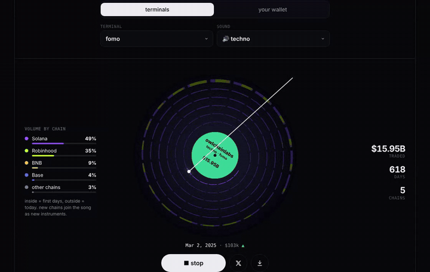

# 💿 wallet vinyl

your solana trades pressed on a vinyl record. press play and hear your wallet.

**try it: [vinyl.owlchainlabs.xyz](https://vinyl.owlchainlabs.xyz)**



> **no private keys. ever.** wallet vinyl only reads public on-chain data.
> no wallet connect, no signing, nothing to approve.

## two records

**wallet vinyl**
- paste any solana address
- every coin you traded is one groove, oldest inside, newest outside
- green grooves are wins, red are losses, width is how much you put in
- wins play higher notes, losses lower ones, the music turns minor when you are down
- your biggest win is the drop, your biggest loss scratches the record
- an ai names the album and the tracks from your real trades
- your record gets its own link: `vinyl.owlchainlabs.xyz/w/<address>`

**terminal vinyl**
- the trading volume of axiom, fomo, gmgn, photon, trojan, bullx, maestro and more
- every groove is a few days of volume, colored by chain
- new chains join the song as new instruments, the all time high is the drop
- every terminal has its own key, lead sound and melody

pick a genre (techno, pop, rap, classic) or let your trading style decide. save the record as a video with sound and post it.

## run it yourself

a static page in `public/` plus a small cloudflare worker (`src/worker.ts`) for `/api/vinyl`, which loads trades server side so your api keys never reach the browser.

```bash
git clone https://github.com/OwlChainLabs/wallet-vinyl
cd wallet-vinyl
npx wrangler secret put HELIUS_API_KEY          # trades (primary)
npx wrangler secret put SOLANATRACKER_API_KEY   # trades (fallback)
npx wrangler secret put ANTHROPIC_API_KEY       # album and track names
npx wrangler deploy
```

all three keys are optional, but without a trade source the wallet tab only shows sample records.

## how the numbers work

- trades come from helius (`getTransactionsForAddress`) with solana tracker as fallback, same as [wallet-roast](https://github.com/OwlChainLabs/wallet-roast)
- one groove per coin: SOL spent is the size, SOL out minus SOL in is the pnl. coins never sold count as lost
- terminal volume comes live from the free [tehcscreener.com](https://tehcscreener.com) api, with a snapshot as fallback

for fun, not financial advice.

## license

MIT · built by [@OwlChainLabs](https://x.com/OwlChainLabs) · terminal data from [tehcscreener.com](https://tehcscreener.com)
